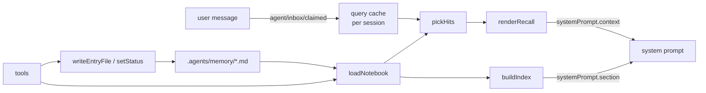
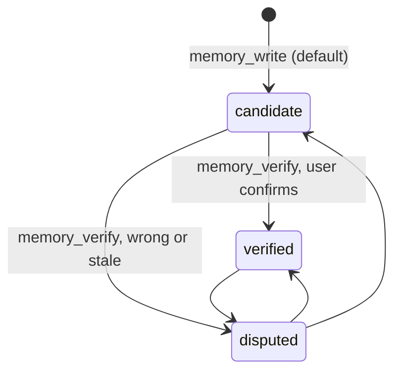

# Architecture

> Owner: @FrozenYty · Revisit when: a harness release lets a linked bundle import harness packages, or
> lexical matching proves to be the wrong bet at this scale.

This document describes the current shape. For *why*, follow the ADR links; where they disagree,
the ADR wins.

## Contents

One paragraph · The three parts · The index is computed, not maintained · Knowing whether it is
working · Which entries are actually used · Host API guard · Capture · Where the policy lives · Data
flow · Turn lifecycle · Cost model · Matching · Trust states · Evidence hygiene · Index drift ·
Failure modes and what prevents them · Harness constraints that shaped the design

## One paragraph

The notebook is a directory of markdown files — one subject per file, an optional `INDEX.md` fixing
order, optional frontmatter. The plugin owns no content. It publishes a bounded, ordered list of
filenames into the system prompt, and when a user message matches an entry it publishes that entry
through the runtime context channel for the turn. Nothing is embedded, nothing is consolidated, and no
model call happens on the read path. An empty notebook costs nothing.

The measured limit is worth stating here rather than in a footnote: matching is lexical, so it fires
when a question uses words the entry already contains, and misses most questions phrased from the
symptom instead. See [Matching](#matching) for the numbers.

## The three parts

| Part | Harness mechanism | Cost when idle |
|---|---|---|
| Index | `ctx.systemPrompt.section` (`order` 4100) | 0 bytes if the notebook is empty |
| Recall | `ctx.systemPrompt.context` (`order` 4101) | 0 bytes when nothing matches |
| Capture hint | `ctx.systemPrompt.context` (`order` 4102) | 0 bytes until the window fills |
| Tools | `ctx.tools.register` × 7 | tool schemas only |

Both prompt parts are registered globally, not per agent, because the content is derived from the
session working directory rather than from the agent's history. Both are pure functions of the
filesystem plus one cache, so neither writes session events.

## The index is computed, not maintained

`INDEX.md` is rebuilt from a directory scan, and **the order is computed on every sync** — see
[ADR 0017](adr/17-index-order-from-use.md). Five tiers: `verified` read in the last 30 days, `verified`
otherwise, `candidate` read in the last 30 days, `candidate` otherwise, `disputed` last. Within a tier
the sort key is `max(last read, file modified)`, and a filename breaks the tie.

Both halves of that matter. **The 30-day window** stops a single busy week from hardening into a
permanent position. **The `max(...)` key** is what keeps a cold start from being permanent: ranking by
last read alone puts an entry with no history below every used one forever, so it is never reachable
from the index and never accumulates the history it would need to climb. A freshly written entry has a
recent modification time, so it lands ahead of one read months ago without anyone reordering a file.
**The tie-break** is not cosmetic: entries written in one session share a timestamp and the scan order
comes from the filesystem, so without it the same notebook produces a different `INDEX.md` on the next
run and every sync rewrites a file that did not change.

`syncIndexFile` runs on every plugin write, on a status change, and once per directory per process, so
a directory changed by another tool is reconciled rather than left to rot.

`indexBudgetChars` caps what is **resident**, not what the notebook can hold. Entries past it are
counted in the index — `… and N more, all listed by memory_list` — because a counted omission is not a
silent one; every entry stays recallable and `memory_list` names them. The default is 9000, which names
about a hundred entries; at 2800 it named about thirty, and the gap showed up as entries nobody could
see without asking.

It also gates when `INDEX.md` is re-ranked, and that half exists for the **prompt cache**, not for
memory. The index is a `systemPrompt.section`, so any change to it invalidates the cache from the first
changed line — the whole conversation behind it is recomputed. A write changes the index and there is no
way around that; a read does not change any entry, and must therefore not change the index either. Since
`usage.jsonl` feeds the ranking, re-ranking on every sync was exactly the path by which one session's
reads reordered the next session's prompt. So the order is recomputed **only when the notebook no longer
fits the budget**: below that threshold every entry is named regardless of position, the ranking decides
nothing, and the order is preserved with new entries on top. Past it, position is the only thing that
decides who is visible, and the ranking is worth the cache it costs.

A write therefore never fails on budget. It reports `indexResident` and `indexOverflow` instead, so the
writer learns whether the entry is visible and what it cost. See
[ADR 0009](adr/09-derived-index-and-write-refusal.md) for the derived index and
[ADR 0014](adr/14-index-budget-is-residency.md) for why the refusal was withdrawn.

## Knowing whether it is working

A notebook that cannot be read and a notebook with nothing relevant both return no hits, and a query
result cannot tell them apart. The user then concludes the feature is useless while the plugin is
either fine or broken, and either way silent.

`memory_health` answers the capability question instead: can the directory be read and written, does
the index agree with it, how much room is left, which entries lack triggers or evidence, and whether
this session injected anything. It reports `ok`, `degraded`, `broken`, `absent` or `unconfigured` — and
`absent` is not a failure, because a plugin that has never been written to has no directory and
creating one everywhere would be worse.

See [ADR 0012](adr/12-health-check.md).

## Which entries are actually used

Recall writes one line per published entry to `usage.jsonl` beside the entries — a date and an entry
name, and nothing else. `memory_usage` reports which entries have never been published and which have,
counted per entry rather than in aggregate, because a total hides the one entry nobody uses.

The log sits in the notebook, not in a cache, because usage history cannot be rebuilt from the entries.
The privacy bound is deliberate: no query text, no session id, no path. The cost is that it cannot
answer "which query failed to match", so vocabulary is grown by reading conversations rather than by
mining a transcript. See [ADR 0013](adr/13-usage-counts.md).

## Host API guard

`apply` checks the host APIs it needs — `systemPrompt.section`, `systemPrompt.context`,
`tools.register` — and throws when one is missing. The `inject` declaration covers the services, but a
host release can keep a service and change its shape, and a plugin that silently does nothing is worse
than one that fails to load: nothing tells the user which happened. The error says so explicitly —
this is a load failure, not an empty notebook.

## Capture

The plugin makes the notebook usable; nothing made it written to. Capture depended entirely on the
model deciding, mid-task, that something was worth keeping — the most expensive moment to ask and the
least reliable.

When context pressure crosses `captureHintRatio` (default 0.6), a one-shot hint is published for the
session: the conversation is close to compaction, a summary will not keep everything, write anything
that was hard to work out. It names the shape worth keeping and says to ignore it otherwise. It
**writes nothing** — the model decides.

This is deliberately not the automatic capture that `EverOS` implements (raw events appended at every
turn boundary, batch extraction later). That design is better and it is the one to adopt if this
plugin ever grows a store; it also costs a buffer whose lifecycle, failure modes and reconciliation
need their own design, which is too much for a plugin whose selling point is that installing it is
free. See [ADR 0010](adr/10-capture-hint.md).

## Where the policy lives

The rules for writing into the notebook — what earns an entry, the two shapes, the entry format,
how entries age — are themselves an entry: `notebook-policy.md`, so they travel with the entries they
govern.

That entry ships with the plugin as `templates/notebook-policy.md`. The plugin seeds it into a
notebook directory that exists but carries no policy: exclusive create, so an edited copy is never
overwritten; once per directory per process; and only where `.agents/memory/` already exists, so
installing the plugin does not create directories in every project the agent opens. When no policy
is present, the index header simply does not name one.

The seeded policy is `status: verified`: it is granted, not observed. It carries an `Evidence:` line
saying it is a policy rather than a claim, so the audit does not flag it.

Nothing in the plugin enforces the policy. The plugin enforces what it can check mechanically —
`evidence` on write, `disputed` filtering, the trust states — and the rest is prose the model reads
when a message mentions memory. See [ADR 0008](adr/08-policy-template-and-seeding.md).

## Data flow



## Turn lifecycle

1. The user's message is claimed onto the inbox; `agent/inbox/claimed` stores it as the session's
   current query and drops the previous turn's recall answer.
2. Prompt assembly runs `section` and `context` for the step. The index is rebuilt from disk; recall
   matches the cached query the first time this turn and caches its answer.
3. Every later step of the same turn returns the identical recall text, so the reusable prefix stays
   stable.
4. `session/disposed` clears the session's three maps.

The recall answer is keyed by the query string. A new turn clears it; the same turn reuses it. That
is what keeps one turn from paying for recall on every step.

## Cost model

- Index: one line per entry — the filename and a summary clipped to `indexSummaryChars`, default 60.
  Around 94 characters and ~24 tokens per entry, so `indexBudgetChars` at its default 2800 names about
  29 entries for ~700 tokens. `indexSummaryChars: 0` restores bare filenames at ~34 characters and ~10
  tokens each, which fits roughly 75 in the same budget — more entries, less about each. Either way the
  rest are counted rather than dropped: capacity is unbounded, and only the token cost is chosen. See
  [ADR 0016](adr/16-index-carries-summaries.md).
- Recall: at most `maxRecall` entries, each clamped to `recallBudgetChars` total including wrapper.
  A single long entry measured 1,399 characters (~390 tokens) at the default budget.
- Per-session suppression: an entry is injected at most once per session. Asking the same kind of
  question twice does not pay twice.
- Zero when idle: an empty notebook and a non-matching message both produce empty strings, which the
  harness drops rather than sending.

## Matching

`pickHits` scores every candidate against the query's token set.

- **Tokenising:** lowercase, then extract Latin runs and CJK runs **separately**. Splitting on
  non-word characters was wrong for mixed script: `mcp挂了` has no separator, so it stayed one token,
  was classified as CJK, and was shredded into bigrams (`mc`, `cp`, `p挂`, `挂了`) — the word `mcp`
  vanished. Typing mixed script without spaces is the normal case for a Chinese user, so the two
  scripts must be separated explicitly. CJK runs become bigrams.
- **Weights:** each query token contributes once, at its strongest field — filename 4, title 3,
  body 1. Triggers outrank all of them: a single-word trigger scores 5, a multi-word trigger 7.
- **A trigger is a phrase, and it counts only whole.** Every word of the phrase must be present for
  the trigger to score at all. This is what stops a generic word from carrying a specific phrase — a
  message containing "denied" does not match the trigger "dotnet pipe denied". Without this rule, a
  phrase's specific weight leaks into every message that shares one of its words. A matched phrase
  also counts one hit per word, so a three-word phrase clears the two-hit floor on its own; that is
  what lets a short message ("mcp 挂了") recall one entry without lowering the floor for ordinary
  single words.
- **A single-word trigger that also names the entry counts two.** A word that is both a trigger and
  part of the filename is that entry's identifier — `tls`, `mcp`, `platformio` — and one of them is
  enough evidence alone.
- **A whole Chinese word of two or more characters also counts two.** Bigrams make this uneven: a
  two-character word is one bigram and counts one hit, a three-character word is two and counts two,
  so `贡献者` recalled alone while `相机` did not — equally specific words treated differently. A
  Chinese word can never become an identifier either, because filenames are ASCII. A single Chinese
  character is excluded, because those are exactly the fragments bigrams produce from sentences.
- **A hit needs a strong match, not just body words.** A trigger, the filename, or the title must
  match; body-only evidence never recalls. Body text is the largest set and the weakest signal, and
  it accumulates: a long entry that quoted the sentence "今天天气怎么样" collected six body hits from
  that sentence and recalled on nothing but coincidence. An entry's subject is what its name, title
  and triggers say it is; the body explains, it does not identify.
- **A word only one entry claims counts as two hits.** This is the same rule as the filename, applied
  to vocabulary: a term that identifies exactly one entry identifies it wherever the term is written.
  It is not IDF — the question is whether a term *distinguishes*, not how rare it is — and it needs no
  maintenance, because a term stops being unique the moment a second entry wants it. The rule
  converges: at twenty-three entries the real notebook has eighty shared terms and no longer grants a
  lone `readme`.
- **Ties break on evidence count, not recency.** A camera question scored the camera entry and the
  sandbox-pipe entry equally, because "access denied" appears in both bodies; the camera entry matched
  six terms to four, and recency was deciding what the model saw.
- **The cap is two.** `tls` appears in the trigger, the name, the title and the body; counting every
  field would let one common word clear any floor.
- **Threshold:** at least `minRecallHits` distinct tokens (default 2) and a weighted score of at
  least `minRecallScore` (default 4). Two independent conditions, because a single high-weight token
  should not be enough and a pile of body hits should not be either.
- **Gating before matching:** a query shorter than `minQueryChars`, or one that is only an
  acknowledgement, never matches.
- **Prefix tolerance, with a floor.** A query word matches a trigger, name or title word when one is
  the other's prefix and both reach five characters (`configure` ~ `configuration`). Below five
  characters the match must be exact — otherwise `env` would match every `environment` and the field
  would stop discriminating. Prefix scanning is limited to the three small sets; the body set is
  large and stays exact.

Note what these rules require of the vocabulary: a trigger that can reach the floor alone must be
specific enough to deserve it. Granting Chinese words their second hit immediately exposed seven
single-word triggers (`重启`, `路径`, `下载`, `描述`, `清单`, `表格`, `计数`) that were too broad to
stand alone — each recalled an unrelated entry from ordinary talk. Every one became a phrase. The
matching rules and the vocabulary have to be tuned together; neither is correct on its own.

### What it measures

Four sets, run against the author's notebook. The first three are committed as
[`tests/qrels.json`](../tests/qrels.json); the fourth is the one that changed the default.

| Set | Result | What it means |
|---|---|---|
| Queries in the notebook's own vocabulary | 52/52 | the rules work as designed |
| Written blind, avoiding that vocabulary | 6/18 | the rules generalise poorly |
| Off-topic queries sharing vocabulary | 0/24 false positives | precision holds — on a set the author wrote |
| **Ordinary talk sharing vocabulary** | **5/18 fired** | precision does not hold on a set the author did not write |

The third and fourth rows disagree because of who wrote them. `qrels.json`'s off-topic queries were
composed by the same person who composed the triggers, so they avoid the words that would have
misfired; an exam certificate, a laptop screen, and a remark about plugins were not composed to be
fair. They fire because the tokeniser grants a word of two or more CJK characters the weight of two
hits — a rule added so that a two-character word could recall alone — and that same weight then applies
to any word carrying two everyday senses.

A threshold sweep shows the gate cannot separate the two populations:

```
score hits | recall | false positives
    4    2 |  6/18  |  5/18
    5    2 |  6/18  |  5/18
    6    2 |  2/18  |  1/18
    8    2 |  1/18  |  0/18
    4    3 |  1/18  |  0/18
```

Correct recalls and false positives both score 4–5 — each is "one generic term plus one specific one" —
so the cliff between 5 and 6 costs four of six correct recalls. **This is why the fix was not a
threshold.** `recallEnabled` now defaults to false and the model reads the index itself; see
[ADR 0015](adr/15-recall-is-model-driven-by-default.md).

Ten of the fourteen blind queries scored **zero** — matched nothing at all, not "matched the wrong
entry". The diagnosis was vocabulary: every trigger had been written by the author in the entry's
technical register, while the question described a symptom.

| Typed | Listed |
|---|---|
| it broke when I moved to another machine | forwarding, absolute path, drive letter |
| the browser works but the command does not | curl, tls, schannel |
| the photos come out black | black frame, white balance |
| why did it not remember | trigger, recall rate |

These are the English equivalents of the measured set, which was written in Chinese. The tokeniser
examples elsewhere in this section keep their original script, because the bigram behaviour they
describe cannot be shown in a language without one.

Adding the symptom phrasings took that same set to 11/11 with false positives still zero. **Nothing
in the algorithm changed.** So the lever is vocabulary, and the limit is that vocabulary has to be
written ahead of the question it will answer — which is why the useful mental model is a well-indexed
notebook, not an assistant that remembers on your behalf.

Deliberately no synonyms and no embeddings. A wrong recall costs tokens and trust; a missed recall is
visible and fixable by adding a trigger. The survey behind that choice found that every published
memory benchmark it checked failed checking, and that the two projects which measured hybrid retrieval
could not show it moving answer quality at all.

## Trust states



`disputed` entries are filtered out of both the index and the candidate set — they are invisible
rather than annotated. `candidate` is injected with a `(candidate)` label; `verified` is injected
bare. The state is a frontmatter field, so it survives without the plugin and is visible in
`git diff`.

## Evidence hygiene

Writing evidence and checking it are separate problems. `scripts/check-evidence.mjs` and the
`memory_audit` tool audit two properties a script can compute safely:

- **Completeness** — does the entry carry an `Evidence:` line at all?
- **Age** — was the file modified within `--stale-days` (default 90)?

They never execute the recorded commands. A notebook is arbitrary markdown; a verifier that runs
whatever it finds is an arbitrary-code surface. Age is the honest proxy: an untouched entry is the
one most likely to carry stale evidence, and the timestamp comes from the filesystem, so a hand edit
moves it too. Reviewing an entry through `memory_verify` refreshes that timestamp.

Audit is informational by default and fails only under `--strict`. See
[ADR 0006](adr/06-evidence-audit-by-age.md).

## Index drift

`scripts/check-index.mjs` and the `memory_audit` tool check both directions between `INDEX.md` and
the directory. A file nobody listed is invisible from outside — the injected index never names it.
A listed file that is gone makes the index lie to whoever reads it next. Neither surfaces as an
error anywhere else.

The policy asks for this check after every add or retire; the script makes it a command instead of a
habit. A missing `INDEX.md` is not drift: ordering falls back to modification time.

## Failure modes and what prevents them

| Failure | Prevention |
|---|---|
| A note exists but is never read | The filename index is unconditional, so the name is always in front of the model while it is resident |
| An entry falls out of the index and nobody notices | The overflow is **counted** in the index, and `memory_health` reports it as `degraded` |
| A stale note keeps being injected | `disputed` is a one-word state change; nothing else is needed |
| Recall floods the context | Two caps (entry count, characters) plus per-session suppression |
| The index grows until it is truncated into uselessness | It is no longer truncated: the budget caps residency and the remainder is counted |
| A wrong fact is recalled confidently | Evidence is mandatory on write and preserved through clamping |
| The plugin breaks a session on resume | No custom session events; all state is derived or in files |
| **The plugin silently fails to load** | The host API guard throws; the tool-schema rules are copied into the test suite |
| **Memory is broken and looks like "nothing matched"** | `memory_health` checks capability separately from results, including whether the notebook is writable |
| **Dead entries accumulate** | `memory_usage` names the entries recall has never published |

## Harness constraints that shaped the design

- **A profile-linked bundle cannot import `@deepseek-ai/*`.** The profile sets
  `autoInstallPeers: false` and `nodeLinker: hoisted`, and pnpm does not install dependencies into a
  linked directory. Node resolves bare specifiers from the bundle's own real path, so neither the
  profile nor the harness installation is an ancestor. Consequence: see
  [ADR 0001](adr/01-zero-dependency-host-half.md).
- **No custom session event types.** A session log carrying a type outside the harness catalog
  refuses to reopen, and `Session.append` cannot set the `ignorable` marker. All state is therefore
  files plus in-memory maps.
- **Prompt text goes through the prompt services.** Listening to `system-prompt/assemble` to add
  text would fight every other contributor; `section` and `context` are the supported surfaces.
