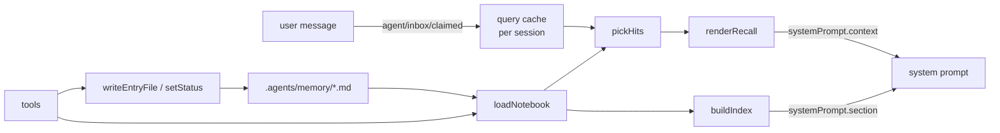
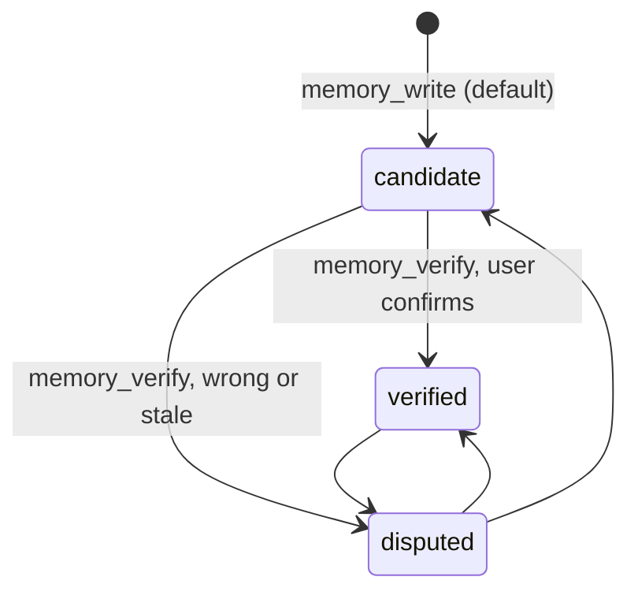

# Architecture

> Owner: @FrozenYty · Revisit when: the notebook stops fitting in the index budget, or a harness
> release lets a linked bundle import harness packages.

This document describes the current shape. For *why*, follow the ADR links; where they disagree,
the ADR wins.

## One paragraph

The notebook is a directory of markdown files — one subject per file, an optional `INDEX.md` fixing
order, optional frontmatter. The plugin owns no content. It publishes the bare file list into the
system prompt, and when a user message matches an entry it publishes that entry through the runtime
context channel for the turn. Nothing is embedded, nothing is consolidated, and no model call
happens on the read path. An empty notebook costs nothing.

## The three parts

| Part | Harness mechanism | Cost when idle |
|---|---|---|
| Index | `ctx.systemPrompt.section` (`order` 4100) | 0 bytes if the notebook is empty |
| Recall | `ctx.systemPrompt.context` (`order` 4101) | 0 bytes when nothing matches |
| Tools | `ctx.tools.register` × 4 | tool schemas only |

Both prompt parts are registered globally, not per agent, because the content is derived from the
session working directory rather than from the agent's history. Both are pure functions of the
filesystem plus one cache, so neither writes session events.

## Where the policy lives

The rules for writing into the notebook — what earns an entry, the two shapes, the entry format,
how entries age — are themselves an entry: `notebook-policy.md`, so they travel with the entries they
govern.

That entry ships with the plugin as `templates/notebook-policy.md`. The plugin seeds it into a
notebook directory that exists but carries no policy: exclusive create, so an edited copy is never
overwritten; once per directory per process; and only where `.agents/memory/` already exists, so
installing the plugin does not create directories in every project the agent opens. When no policy
is present, the index header simply does not name one.

The seeded policy is `status: verified`: it is granted, not observed. It carries an `Evidence:` line
saying it is a policy rather than a claim, so the audit does not flag it.

Nothing in the plugin enforces the policy. The plugin enforces what it can check mechanically —
`evidence` on write, `disputed` filtering, the trust states — and the rest is prose the model reads
when a message mentions memory. See [ADR 0008](adr/08-policy-template-and-seeding.md).

## Data flow

## Turn lifecycle

1. The user's message is claimed onto the inbox; `agent/inbox/claimed` stores it as the session's
   current query and drops the previous turn's recall answer.
2. Prompt assembly runs `section` and `context` for the step. The index is rebuilt from disk; recall
   matches the cached query the first time this turn and caches its answer.
3. Every later step of the same turn returns the identical recall text, so the reusable prefix stays
   stable.
4. `session/disposed` clears the session's three maps.

The recall answer is keyed by the query string. A new turn clears it; the same turn reuses it. That
is what keeps one turn from paying for recall on every step.

## Cost model

- Index: one line per entry, no descriptions. Eleven entries measured 620 characters (~172 tokens).
  The only ceiling is `indexBudgetChars`, and it is reached only by a notebook far larger than this
  one.
- Recall: at most `maxRecall` entries, each clamped to `recallBudgetChars` total including wrapper.
  A single long entry measured 1,399 characters (~390 tokens) at the default budget.
- Per-session suppression: an entry is injected at most once per session. Asking the same kind of
  question twice does not pay twice.
- Zero when idle: an empty notebook and a non-matching message both produce empty strings, which the
  harness drops rather than sending.

## Matching

`pickHits` scores every candidate against the query's token set.

- **Tokenising:** lowercase, split on everything but `[a-z0-9]` and CJK, then CJK runs become
  bigrams. Bigrams are what let a two-character Chinese word match without a dictionary.
- **Weights:** each query token contributes once, at its strongest field — filename 4, title 3,
  body 1. Triggers outrank all of them, because they are the author's own recall vocabulary: a
  single-word trigger scores 5, a multi-word trigger scores 7.
- **A trigger is a phrase, and it counts only whole.** Every word of the phrase must be present for
  the trigger to score at all. This is what stops a generic word from carrying a specific phrase — a
  message containing "denied" does not match the trigger "dotnet pipe denied". Without this rule, a
  phrase's specific weight leaks into every message that shares one of its words. A matched phrase
  also counts one hit per word, so a three-word phrase clears the two-hit floor on its own; that is
  what lets a short message ("mcp 挂了") recall one entry without lowering the floor for ordinary
  single words.
- **Threshold:** at least `minRecallHits` distinct tokens (default 2) and a weighted score of at
  least `minRecallScore` (default 4). Two independent conditions, because a single high-weight token
  should not be enough and a pile of body hits should not be either.
- **Gating before matching:** a query shorter than `minQueryChars`, or one that is only an
  acknowledgement, never matches.
- **Prefix tolerance, with a floor.** A query word matches a trigger, name or title word when one is
  the other's prefix and both reach five characters (`configure` ~ `configuration`). Below five
  characters the match must be exact — otherwise `env` would match every `environment` and the field
  would stop discriminating. Prefix scanning is limited to the three small sets; the body set is
  large and stays exact.

Deliberately no synonyms and no embeddings. A wrong recall costs tokens and trust; a missed recall
is visible and fixable by adding a trigger.

## Trust states

`disputed` entries are filtered out of both the index and the candidate set — they are invisible
rather than annotated. `candidate` is injected with a `(candidate)` label; `verified` is injected
bare. The state is a frontmatter field, so it survives without the plugin and is visible in
`git diff`.

## Evidence hygiene

Writing evidence and checking it are separate problems. `scripts/check-evidence.mjs` and the
`memory_audit` tool audit two properties a script can compute safely:

- **Completeness** — does the entry carry an `Evidence:` line at all?
- **Age** — was the file modified within `--stale-days` (default 90)?

They never execute the recorded commands. A notebook is arbitrary markdown; a verifier that runs
whatever it finds is an arbitrary-code surface. Age is the honest proxy: an untouched entry is the
one most likely to carry stale evidence, and the timestamp comes from the filesystem, so a hand edit
moves it too. Reviewing an entry through `memory_verify` refreshes that timestamp.

Audit is informational by default and fails only under `--strict`. See
[ADR 0006](adr/06-evidence-audit-by-age.md).

## Index drift

`scripts/check-index.mjs` and the `memory_audit` tool check both directions between `INDEX.md` and
the directory. A file nobody listed is invisible from outside — the injected index never names it.
A listed file that is gone makes the index lie to whoever reads it next. Neither surfaces as an
error anywhere else.

The policy asks for this check after every add or retire; the script makes it a command instead of a
habit. A missing `INDEX.md` is not drift: ordering falls back to modification time.

## Failure modes and what prevents them

| Failure | Prevention |
|---|---|
| A note exists but is never read | The filename index is unconditional, so the name is always in front of the model |
| A stale note keeps being injected | `disputed` is a one-word state change; nothing else is needed |
| Recall floods the context | Two caps (entry count, characters) plus per-session suppression |
| The index grows until it is truncated into uselessness | No descriptions to truncate; bare filenames are the cheapest possible line |
| A wrong fact is recalled confidently | Evidence is mandatory on write and preserved through clamping |
| The plugin breaks a session on resume | No custom session events; all state is derived or in files |

## Harness constraints that shaped the design

- **A profile-linked bundle cannot import `@deepseek-ai/*`.** The profile sets
  `autoInstallPeers: false` and `nodeLinker: hoisted`, and pnpm does not install dependencies into a
  linked directory. Node resolves bare specifiers from the bundle's own real path, so neither the
  profile nor the harness installation is an ancestor. Consequence: see
  [ADR 0001](adr/01-zero-dependency-host-half.md).
- **No custom session event types.** A session log carrying a type outside the harness catalog
  refuses to reopen, and `Session.append` cannot set the `ignorable` marker. All state is therefore
  files plus in-memory maps.
- **Prompt text goes through the prompt services.** Listening to `system-prompt/assemble` to add
  text would fight every other contributor; `section` and `context` are the supported surfaces.
