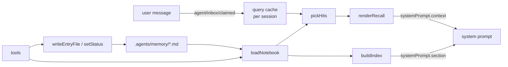
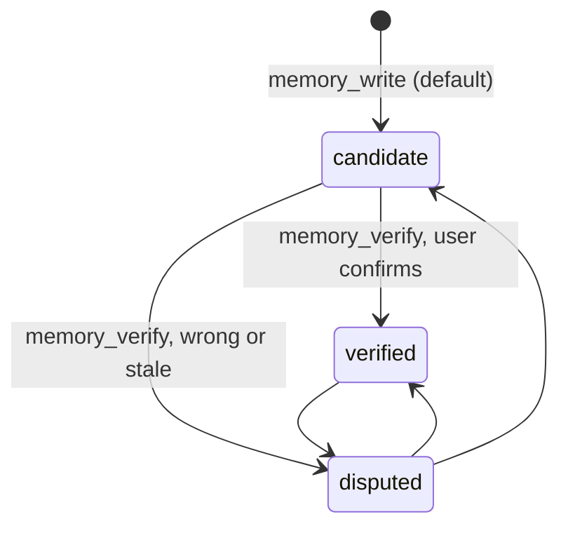

# 架构

> 英文版：[architecture-en.md](architecture-en.md)。**英文版是权威**，两份冲突时以它为准。

> 维护者：@FrozenYty · 何时重看：某次 harness 版本让"链接进来的 bundle 能 import harness 包"，或者
> 词法匹配在这个规模上被证明押错了。

这份文档描述当前的形状。要问**为什么**，跟 ADR 链接走；两者冲突时以 ADR 为准。

## 目录

一段话 · 三个部分 · 索引是算出来的，不是维护出来的 · 怎么知道它在工作 · 哪些条目真的被用 · 宿主 API 守卫 ·
捕获 · 政策住在哪里 · 数据流 · 一轮的生命周期 · 代价模型 · 匹配 · 信任状态 · 证据卫生 · 索引漂移 ·
失效模式与阻止它的东西 · 塑造了设计的宿主约束

## 一段话

笔记本是一个 markdown 文件目录——一个文件一个主题，可选的 `INDEX.md` 固定顺序，可选 frontmatter。插件不拥有
任何内容。它把一份有界、有序的文件名清单放进 system prompt，并在用户消息匹配到某条时，把那条通过运行时上下文
通道发布给这一轮。没有任何东西被向量化，没有任何东西被归并，读路径上也不发生任何模型调用。空笔记本零代价。

**测出来的限度值得写在这里而不是脚注里**：匹配是词法的，所以当问题用了条目里已有的词，它会触发；而用**症状**
措辞的问题，多数会漏掉。数字见[匹配](#匹配)一节。

## 三个部分

| 部分 | harness 机制 | 空闲时代价 |
|---|---|---|
| 索引 | `ctx.systemPrompt.section`（`order` 4100） | 空笔记本时为 0 字节 |
| 召回 | `ctx.systemPrompt.context`（`order` 4101） | 无匹配时为 0 字节 |
| 捕获提示 | `ctx.systemPrompt.context`（`order` 4102） | 窗口填满前为 0 字节 |
| 工具 | `ctx.tools.register` × 7 | 仅工具 schema |

两段提示都是**全局**注册而非按 agent，因为内容来自会话工作目录，而不是 agent 的历史。两者都是"文件系统 + 一个
缓存"的纯函数，所以都不写会话事件。

## 索引是算出来的，不是维护出来的

`INDEX.md` 由目录扫描重建，而**顺序在每次同步时重算**——见 [ADR 0017](adr/17-index-order-from-use.md)。
五层：30 天内读过的 `verified`、其余 `verified`、30 天内读过的 `candidate`、其余 `candidate`、最后
`disputed`。层内排序键是 `max(最后读取时间, 文件修改时间)`，并列时按文件名。

这两半都重要。**30 天窗口**防止某一个忙碌的一周硬化成永久位置。**`max(...)` 键**是让冷启动不会永久的
东西：只按最后读取排序，会把没有历史的条目永远排在每一个用过的条目之下，于是它永远无法从索引被看到，
也就永远积累不出让它上浮的历史。刚写入的条目修改时间很新，所以它会排到几个月前被读过一次的那条之前，
而无需任何人手工调顺序。**并列时的文件名兜底**不是装饰：同一会话写入的条目时间戳相同，而扫描顺序来自
文件系统，没有它的话同一个笔记本下次运行会产出不同的 `INDEX.md`，每次同步都在重写一个其实没变的文件。

`syncIndexFile` 在每次插件写入、每次状态变更、以及每个目录每进程一次时运行，所以被别的工具改过的目录会被
对账，而不是任其腐烂。

`indexBudgetChars` 限制的是**常驻**，不是笔记本能装多少。超出的条目会在索引里被计数——`… and N more,
all listed by memory_list`——因为被计数的省略不是静默的省略；每条仍可被召回，`memory_list` 会点名它们。
默认 9000，大约列出 100 条；2800 时只列出约 30 条，而这个差距表现为"有些条目不去问就看不见"。

因此**一次写入永远不会因为预算而失败**。它改为报告 `indexResident` 和 `indexOverflow`，写的人由此知道这条是否
可见、代价是什么。派生索引见 [ADR 0009](adr/09-derived-index-and-write-refusal.md)，拒绝写入为何被撤销见
[ADR 0014](adr/14-index-budget-is-residency.md)。

## 怎么知道它在工作

读不了的笔记本和没有相关内容可给的笔记本都返回零命中，而一次查询的结果分不清两者。用户于是得出结论"这功能没用"，
而插件其实要么正常、要么坏了，两种情况都不出声。

`memory_health` 改为回答**能力**问题：目录能否读写、索引与目录是否一致、还剩多少空间、哪些条目缺触发词或证据、
以及本次会话是否注入过内容。它报告 `ok`、`degraded`、`broken`、`absent` 或 `unconfigured`——而 `absent` 不是
失败，因为一个从来没被写过的插件没有目录，而在每个项目里都创建一个会更糟。

见 [ADR 0012](adr/12-health-check.md)。

## 哪些条目真的被用

召回会往条目旁边的 `usage.jsonl` 写一行：一个日期和一个条目名，没有别的。`memory_usage` 报告哪些条目从未被
发布、哪些被过，**按条目计数而非汇总**，因为总数会藏起那条没人用的。

日志放在笔记本里而不是缓存里，因为使用历史没法从条目重建。隐私边界是故意的：没有查询文本、没有会话 id、没有路径。
代价是它答不了"哪次查询没匹配上"，所以词汇是靠读对话长出来的，不是靠挖一份记录。见 [ADR 0013](adr/13-usage-counts.md)。

## 宿主 API 守卫

`apply` 会检查它需要的宿主 API——`systemPrompt.section`、`systemPrompt.context`、`tools.register`——缺一个就
抛错。`inject` 声明覆盖了服务，但某个宿主版本可能保留服务却改变它的形状，而**一个静默不做事的插件比一个加载失败
的更糟**：没有任何东西告诉用户发生了哪一种。错误信息会明确说出来——**这是一次加载失败，不是一个空笔记本。**

## 捕获

插件让笔记本可用；但**没有任何东西让它被写过**。捕获过去完全依赖模型在任务中途决定某事值得留下——那是最贵的
提问时机，也是最不可靠的。

当上下文压力越过 `captureHintRatio`（默认 0.6），会为本次会话发布一次性的提示：对话接近压缩，摘要不会保留一切，
把难以想清楚的东西写下来。它点名值得保留的形状，并说否则请忽略。**它什么都不写**——决定权在模型。

这**有意不是** `EverOS` 实现的那种自动捕获（在每次轮次边界追加原始事件、之后再批量抽取）。那个设计更好，如果
这个插件将来长出存储层，就该采用它；但它也带来一个缓冲，其生命周期、失效模式和对外核对都需要单独设计，对一个
卖点就是"装了不花钱"的插件来说太多了。见 [ADR 0010](adr/10-capture-hint.md)。

## 政策住在哪里

写进笔记本的规则——什么值得一条、两种形状、条目格式、条目如何老化——本身也是一条条目：`notebook-policy.md`，
于是它跟着它所管辖的条目一起走。

这条条目随插件发布为 `templates/notebook-policy.md`。插件把它播种进一个**已经存在但没有政策**的笔记本目录：
独占创建，所以被编辑过的副本永不被覆盖；每个目录每进程一次；且只在 `.agents/memory/` 已存在的地方，所以装插件
不会在 agent 打开的每个项目里创建目录。没有政策时，索引头就干脆不提它。

被播种的政策是 `status: verified`：它是**被授予的**，不是被观察到的。它带一条 `Evidence:` 行，说明它是政策而非
断言，所以审计不会标记它。

**插件里没有任何东西强制执行政策。** 插件只强制它能机械检查的部分——写入时的 `evidence`、`disputed` 过滤、信任
状态——其余是模型在消息提到记忆时读到的散文。见 [ADR 0008](adr/08-policy-template-and-seeding.md)。

## 数据流



## 一轮的生命周期

1. 用户消息被领取到 inbox；`agent/inbox/claimed` 把它存为会话当前查询，并丢弃上一轮的召回答案。
2. 提示装配为这一步运行 `section` 和 `context`。索引从磁盘重建；召回在本轮第一次匹配缓存查询，并缓存答案。
3. 同一轮的后续每一步返回**完全相同**的召回文本，所以可复用的前缀保持稳定。
4. `session/disposed` 清掉该会话的三张映射表。

召回答案以查询字符串为键。新一轮清掉它；同一轮复用它。**这就是让一轮不会为每一步都付一次召回代价的原因。**

## 代价模型

- 索引：每条一行——文件名，加上裁剪到 `indexSummaryChars`（默认 60）的摘要。每条约 94 字符、约 24 token，所以
  `indexBudgetChars` 默认 2800 时命名约 29 条，约 700 token。`indexSummaryChars: 0` 退回纯文件名，每条约 34 字符、
  约 10 token，同样预算下能装约 75 条——条目更多，每条信息更少。两种情况下其余的都只被**计数**而非丢弃：容量无上限，
  被选择的只是 token 代价。见 [ADR 0016](adr/16-index-carries-summaries.md)。
- 召回：最多 `maxRecall` 条，每条被裁剪到含包装在内共 `recallBudgetChars`。默认预算下，单条长条目实测 1,399 字符
  （约 390 token）。
- 会话内抑制：一条条目每次会话最多注入一次。同一个问题问两遍不会付两次钱。
- 空闲时为零：空笔记本和不匹配的消息都产出空字符串，harness 会丢弃而不发送。

## 匹配

`pickHits` 把每个候选与查询的词集打分。

- **分词：** 先转小写，然后**分开**提取拉丁连续段和 CJK 连续段。按非词字符切分对混排是错的：`mcp挂了` 没有分隔符，
  所以它保持成一个 token，被判定为 CJK，然后被切成 bigram（`mc`、`cp`、`p挂`、`挂了`）——**`mcp` 这个词消失了**。
  中文用户打混排不加空格是常态，所以两种文字必须显式分开。CJK 连续段切成 bigram。
- **权重：** 每个查询词只贡献一次，按它最强的字段——文件名 4、标题 3、正文 1。触发词排在所有之上：单词触发词 5 分，
  多词触发词 7 分。
- **触发词是短语，而且只有整体命中才算。** 短语的每个词都必须出现，触发词才计分。**这就是阻止一个泛词带动一个特定
  短语的东西**——一条含 "denied" 的消息不会匹配触发词 "dotnet pipe denied"。没有这条规则，短语的特定权重会泄漏到
  每一条共享其中某个词的消息里。匹配上的短语还按词数计命中，所以三词短语自己就跨过两命中的门槛；**这就是让一条
  短消息（"mcp 挂了"）能召回一条，又不必为普通单词降低门槛的原因**。
- **同时也是条目名一部分的单词触发词算两次。** 一个词既是触发词又是文件名的一部分，它就是这个条目的标识——`tls`、
  `mcp`、`platformio`——其中一个就足以作为唯一证据。
- **两个汉字以上的完整中文词也算两次。** Bigram 让这件事不均匀：两个字是一个 bigram 算一命中，三个字是两个 bigram
  算两命中，于是 `贡献者` 单独能召回而 `相机` 不能——**同样具体的词被区别对待**。中文词也永远无法成为标识，因为
  文件名是 ASCII。单个汉字被排除在外，因为那正是 bigram 从普通句子里切出来的碎片。
- **一次命中需要强信号，不能只有正文词。** 触发词、文件名或标题必须匹配；只有正文证据永不召回。正文是最大的集合，
  也是最弱的信号，而且它会累积：一条引用了"今天天气怎么样"这句话的长条目，从这一句里收集到六个正文命中，召回靠的
  纯粹是巧合。**条目的主题是它的名字、标题和触发词说它是什么；正文负责解释，不负责识别。**
- **只有一个条目声称的词也算两命中。** 这与文件名是同一条规则，应用到词汇上：一个恰好标识一条条目的术语，无论写在哪里
  都标识它。这**不是 IDF**——问的是一个词**是否区分**，而不是它多稀有——而且无需维护，因为一旦第二条条目也要它，
  它就不再唯一。这条规则会收敛：23 条时，真实笔记本里有 80 个共享术语，不再单独给 `readme` 计分。
- **平局按证据数而不是新旧打破。** 一个相机问题让相机条目和 sandbox-pipe 条目得分相同，因为两个正文里都有
  "access denied"；相机条目匹配了六个词对四个，而此前是"新旧"在决定模型看到什么。
- **上限是二。** `tls` 出现在触发词、名字、标题和正文里；把每个字段都算上会让一个常见词清过任何门槛。
- **阈值：** 至少 `minRecallHits` 个不同词（默认 2），且加权分至少 `minRecallScore`（默认 4）。两个独立条件，因为
  单个高权重词不该够，一堆正文命中也不该够。
- **匹配前先设门：** 短于 `minQueryChars` 的查询，或者只是一句确认的，永不匹配。
- **前缀容忍，但有下限。** 当查询词与触发词/名字/标题词互为前缀，且双方都达到五个字符时匹配（`configure` ~
  `configuration`）。低于五个字符必须精确匹配——否则 `env` 会匹配所有 `environment`，这个字段就不再区分。前缀扫描
  只限于三个小集合；正文集合很大，保持精确。

注意这些规则对词汇提出了什么要求：**一个能单独跨过门槛的触发词，必须具体到配得上这个能力。** 给中文词第二个命中之后，
立刻暴露出七个过宽的单词触发词（`重启`、`路径`、`下载`、`描述`、`清单`、`表格`、`计数`）——每一个都会因日常闲聊
召回不相干的条目。它们全部改成了短语。**匹配规则和词汇必须一起调；单看任何一个都不对。**

### 它测出了什么

四组查询，跑在作者的笔记本上。前三组提交在 [`tests/qrels.json`](../tests/qrels.json)；第四组改变了默认值。

| 组 | 结果 | 含义 |
|---|---|---|
| 用笔记本自己的词汇写的查询 | 52/52 | 规则按设计工作 |
| 盲写，刻意避开那套词汇 | 6/18 | 规则泛化很差 |
| 共享词汇的无关查询 | 0/24 误报 | 精确率成立——在作者自己写的那组上 |
| **共享词汇的日常闲聊** | **5/18 触发** | 精确率不成立——在作者没写的那组上 |

第三行和第四行结论不一致，原因在于**谁写的**。`qrels.json` 的无关查询是写触发词的同一个人的产物，所以它们避开了会
误触发的词；而一张考试证书、一块笔记本屏幕、一句关于插件的话，都不是为了公平而写的。它们触发，是因为分词器给两个
汉字以上的词两个命中的权重——这条规则是为了让两个字的词能单独召回而加的——而同一个权重随之作用于任何承载两个日常
含义的词。

阈值扫描显示这道门分不开这两个分布：

```
分数 命中 | 召回 | 误报
    4    2 |  6/18  |  5/18
    5    2 |  6/18  |  5/18
    6    2 |  2/18  |  1/18
    8    2 |  1/18  |  0/18
    4    3 |  1/18  |  0/18
```

正确召回和误报都落在 4–5 分——各自都是"一个泛词加一个特定词"——所以 5 到 6 之间那道悬崖，代价是六个正确召回里的四个。
**这就是为什么修复不是调阈值。** `recallEnabled` 现在默认为 false，由模型自己读索引；见
[ADR 0015](adr/15-recall-is-model-driven-by-default.md)。

十四条盲写查询里有十条**零分**——什么都没匹配上，而不是"匹配错了条目"。诊断结论是词汇：每条触发词都是作者用条目的
技术语域写的，而问题描述的是症状。

| 用户打的 | 条目里列的 |
|---|---|
| 换台电脑就不对了 | 转发、绝对路径、盘符 |
| 浏览器能开但命令不行 | curl、tls、schannel |
| 照片拍出来是黑的 | 黑帧、白平衡 |
| 怎么没记住 | 触发词、召回率 |

补上症状措辞之后，同一组变成 11/11，误报仍是零。**算法里什么都没改。** 所以杠杆是词汇，而这个限度的内容是：
**词汇必须在它要回答的问题出现之前就被写下来**——这就是为什么有用的心智模型是"一本索引良好的笔记本"，而不是
"一个替你记住的助手"。

有意不要同义词表，也不要向量。一次错误召回消耗 token 和信任；一次漏掉的召回是可见的，加一个触发词就能修。做出这个
选择的调研发现：它检查过的每一个公开记忆基准都没有通过检查，而两个测过混合检索的项目都无法证明它改变了答案质量。

## 信任状态



`disputed` 条目同时从索引和候选集中滤掉——**它们是不可见，而不是被标注**。`candidate` 注入时带 `(candidate)` 标签；
`verified` 裸注入。状态是 frontmatter 字段，所以它不依赖插件就能存活，并且在 `git diff` 里可见。

## 证据卫生

**写证据和检查证据是两个问题。** `scripts/check-evidence.mjs` 和 `memory_audit` 工具审计脚本能安全计算的两个属性：

- **完整性**——条目到底有没有 `Evidence:` 行？
- **年龄**——文件是否在 `--stale-days`（默认 90）内被修改过？

**它们从不执行记录下来的命令。** 笔记本是任意 markdown；一个见到什么就跑什么的校验器，就是一个任意代码执行面。年龄是
诚实的代理：一条没被碰过的条目，最可能承载着已经失效的证据，而时间戳来自文件系统，所以手工编辑也会推动它。通过
`memory_verify` 复核一条条目会刷新这个时间戳。

审计默认只提供信息，只有 `--strict` 时才失败。见 [ADR 0006](adr/06-evidence-audit-by-age.md)。

## 索引漂移

`scripts/check-index.mjs` 和 `memory_audit` 工具检查 `INDEX.md` 与目录之间的**两个方向**。没人列出的文件从外部看是
不可见的——注入索引永不提它。列了但已经不存在的文件，会让索引对它下一个读者撒谎。这两件事在其他任何地方都不会以错误
形式浮现。

政策要求在每次新增或退役之后做这个检查；脚本把它从习惯变成命令。**缺少 `INDEX.md` 不算漂移**：顺序回退到修改时间。

## 失效模式与阻止它的东西

| 失效 | 预防 |
|---|---|
| 笔记存在但从未被读到 | 文件名索引是无条件的，所以只要它常驻，名字就一直在模型面前 |
| 条目掉出索引而无人察觉 | 溢出在索引里被**计数**，且 `memory_health` 把它报为 `degraded` |
| 过时的笔记一直被注入 | `disputed` 是一个词的状态变更；不需要别的 |
| 召回淹没上下文 | 两道上限（条数、字符数）加会话内抑制 |
| 索引一直长到被截断成无用 | 它不再被截断：预算限制常驻条数，其余被计数 |
| 一个错的事实被自信地召回 | 写入时强制证据，并在裁剪过程中保留 |
| 插件在恢复会话时炸掉 | 没有自定义会话事件；所有状态要么派生、要么在文件里 |
| **插件静默加载失败** | 宿主 API 守卫抛错；工具 schema 规则被复制进测试集 |
| **记忆坏了，但看起来像"没匹配上"** | `memory_health` 把能力与结果分开检查，包括笔记本是否可写 |
| **死条目不断累积** | `memory_usage` 点名召回从未发布过的条目 |

## 塑造了设计的宿主约束

- **链接进 profile 的 bundle 不能 import `@deepseek-ai/*`。** profile 设了 `autoInstallPeers: false` 和
  `nodeLinker: hoisted`，而 pnpm 不会把依赖装进一个链接目录。Node 从 bundle 自己的真实路径解析裸说明符，所以
  profile 和 harness 安装都不是它的祖先。后果见 [ADR 0001](adr/01-zero-dependency-host-half.md)。
- **没有自定义会话事件类型。** 一个带有 harness 目录之外类型的会话日志会拒绝重新打开，而 `Session.append` 设不了
  `ignorable` 标记。因此所有状态都是文件加内存映射。
- **提示文本必须走提示服务。** 监听 `system-prompt/assemble` 来加文本会与所有其他贡献者打架；`section` 和
  `context` 是受支持的表面。
